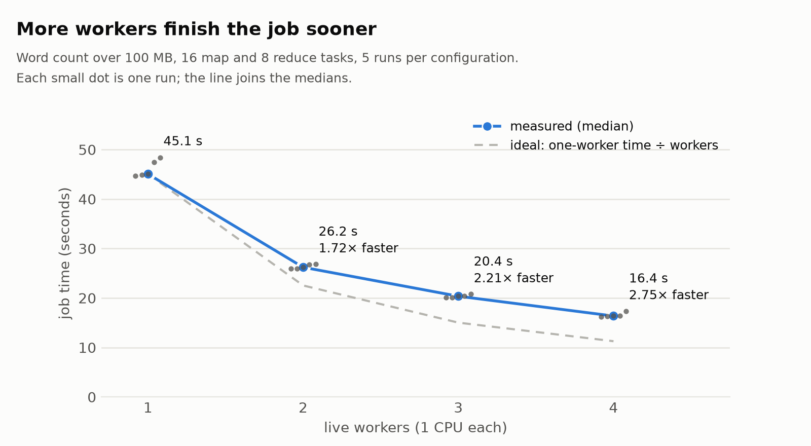

# Performance evaluation

Three experiments, all on the real Docker Compose cluster, all running word
count ([examples/wordcount.py](../examples/wordcount.py)) over 100 MB of text
with 16 map tasks and 8 reduce tasks.

**Results in brief**

- Four workers finish the job 2.75 times faster than one worker (16.4 s
  against 45.1 s).
- Killing a worker in the middle of a job delays the job by one to two
  seconds. The job always finishes.
- In all 56 timed runs, 28 of them with a worker killed mid-job, the output
  was byte-identical to the failure-free output.

## Setup

| | |
|---|---|
| Machine | MacBook Air, Apple M2 (4 performance and 4 efficiency cores), 16 GB RAM |
| Docker | Docker Desktop, engine 29.3.0. Its Linux VM has 8 CPUs and 7.7 GB of memory |
| Cluster | As in [docker-compose.yml](../docker-compose.yml): one boss and four workers, each worker limited to 1 CPU; heartbeat timeout 5 s |
| Data | 100 MB of text in 8 files from [scripts/gen_data.py](../scripts/gen_data.py), seed 0. Word frequencies follow a Zipf distribution, as in real text |
| Job | Word count, 16 map tasks, 8 reduce tasks |
| Timing | Measured by the boss, from the submission of the job to the completion of its last reduce task |

How the runs were made:

- Every configuration was run several times. The plots show every run as a
  dot, and the numbers quoted are medians.
- The configurations were interleaved: one run of each, then the next round.
  In the failure experiment the order also rotates from round to round, so
  each case runs once in each position.
- The script pauses before every run (25 s in the first experiment, 45 s in
  the second). This laptop has no fan and slows down when it gets hot.

Two things to keep in mind when reading the numbers:

- **This is not the course VM.** Absolute times will differ on a 4-CPU Linux
  VM. The commands to repeat the measurements are at the end.
- **The laptop was in use.** Other programs were running, and one system
  process used a full CPU core throughout. A few runs were visibly slowed by
  this. They are shown, not removed.

## 1. More workers finish the job sooner

The same job with one, two, three and four live workers. The other worker
containers were stopped.



| Live workers | Job time in each of 5 runs (s) | Median (s) | Speedup |
|---|---|---|---|
| 1 | 44.7, 44.9, 45.1, 47.4, 48.4 | 45.1 | 1.00× |
| 2 | 25.9, 25.9, 26.2, 26.7, 26.8 | 26.2 | 1.72× |
| 3 | 20.1, 20.1, 20.4, 20.4, 20.8 | 20.4 | 2.21× |
| 4 | 16.2, 16.3, 16.4, 16.4, 17.4 | 16.4 | 2.75× |

Tasks really are spread across the workers: every extra worker shortens the
job. The runs are repeatable, each within 8% of the median for its
configuration.

**Why 2.75× and not 4×?** The boss's scheduling log for each run
([bench/results/events/](../bench/results/events/)) gives two reasons.

| Live workers | Typical map task (s) | Map phase (s) | Reduce phase (s) |
|---|---|---|---|
| 1 | 1.77 | 28.6 | 16.5 |
| 2 | 1.96 | 16.2 | 10.0 |
| 3 | 2.07 | 12.4 | 8.0 |
| 4 | 2.28 | 9.3 | 7.0 |

1. **Tasks get slower when more of them run at once.** A map task takes
   1.77 s when one worker runs alone and 2.28 s when four run together, 29%
   longer. The workers share the machine's memory, the file sharing layer
   between macOS and the Docker VM, and four fast cores, one of which was
   busy with something else. The map phase on its own speeds up 3.1×.
2. **The reduce work is uneven.** Each word goes to one reduce task, and the
   task that gets the most common word has 27% of all the reduce work. It
   takes about 5 s, and the reduce phase cannot be shorter than that. The
   boss also hands out reduce tasks in numerical order, so this one (task 6)
   starts in the second round and finishes last. The reduce phase speeds up
   only 2.4×.

Handing out the largest reduce task first would shorten the four-worker
reduce phase by up to about 1.8 s. The boss could tell which is largest from
the sizes of the intermediate files. This is not implemented.

## 2. A worker failure costs a few seconds

Four cases:

- four workers and no failure;
- four workers, with `worker-2` killed during the map phase;
- four workers, with `worker-2` killed during the reduce phase;
- three workers from the start, for comparison.

The kill is `docker kill mr-worker-2`, one second after `worker-2` has
started a task, so it lands in the middle of the task's work. In the map case
this is after at least 4 of the 16 map tasks have completed. In the reduce
case it is early in the reduce phase, as soon as `worker-2` has spent a
second on a reduce task.


| Case | Job time in each of 4 runs (s) | Median (s) | Extra over no failure | Tasks re-run | Output identical |
|---|---|---|---|---|---|
| 4 workers, no failure | 15.8, 17.1, 17.1, 18.8 | 17.1 | | 0 | 4 of 4 |
| 4 workers, one killed during map | 18.8, 18.9, 19.3, 29.9 | 19.1 | +2.1 s | 1 in every run | 4 of 4 |
| 4 workers, one killed during reduce | 17.2, 18.1, 18.2, 19.0 | 18.2 | +1.1 s | 1 in every run | 4 of 4 |
| 3 workers from the start | 20.6, 21.1, 21.7, 27.4 | 21.4 | +4.3 s | 0 | 4 of 4 |

**The job always finished, and its output was never wrong.** "Output
identical" compares the SHA-256 hash of the output files with that of the
first failure-free run.

**What the logs show for the eight runs with a kill:**

- The boss put the lost task back in the queue 6.1 to 6.5 s after handing it
  out. The worker was killed about one second into the task, so that is
  about 5 s after the kill, which is the configured heartbeat timeout.
- Exactly one task was re-run each time. The tasks `worker-2` had already
  completed were not re-run, because their output was in shared storage.
- The re-run took 2.1 to 3.4 s for a map task and 1.1 to 1.8 s for a reduce
  task.

**What this means:**

- A failure costs less than the 5 s it takes to detect. While the boss waits
  for the timeout, the other three workers keep working on other tasks. The
  delay only holds back the one lost task.
- A failure also costs less than starting with three workers (+4.3 s). The
  design document expected the two to be about equal, plus the detection
  delay. They are not: the job had four workers until the kill, and three
  workers each run a little faster than four (reason 1 in the previous
  section).
- The cost depends on which task is lost and when. In these runs the lost
  reduce task was always one of the small ones. Losing the largest reduce
  task late in the job would cost more: the job would wait for the timeout
  and then for that task to run again. That case was not measured.

**Two slow runs.** The 29.9 s and 27.4 s runs were both in the third round.
In those two runs every task on every worker was slower than usual, which
points to other activity on the laptop, not to the cluster. The medians do
not depend on them.

**Earlier passes of this experiment.** This experiment was run three times.
The first two passes, five rounds each, were discarded for timing: the
laptop was being used and was heating up, and the time of the failure-free
case ranged from 17 to 38 s. That is why the third pass has a longer pause
and a rotating order. The outputs of those 40 runs were checked in the same
way and were all identical too, which gives 56 runs in total, 28 of them
with a kill.

## 3. What a recovery looks like

One run with `worker-2` killed during the map phase, drawn from the boss's
scheduling log
([bench/results/timeline_events.jsonl](../bench/results/timeline_events.jsonl)).


| Time | What happened |
|---|---|
| 2.25 s | The boss hands map task 6 to `worker-2` |
| 3.58 s | `worker-2` is killed |
| 8.46 s | The boss has heard nothing from `worker-2` for 5 s, presumes it dead, and puts map task 6 back in the queue (4.9 s after the kill) |
| 8.55 s | `worker-1` asks for its next task and gets map task 6 |
| 10.62 s | `worker-1` finishes map task 6 |
| 10.93 s | The last map task finishes and the reduce phase starts, on three workers |
| 18.94 s | The job is done |

The picture shows the feature working as designed. The row of `worker-2`
stops at the kill. Its unfinished task reappears on another worker after the
timeout. The map task `worker-2` finished before the kill is not run again.
Between the kill and the timeout, the other three workers carry on with
other tasks.

The last task to finish is reduce task 6 on `worker-3`, which takes 5.0 s.
This is the oversized reduce task from section 1.

## Limits of these measurements

- One laptop, in use, without a fan. The numbers show how the system
  behaves, not how fast it is on server hardware.
- One job (word count) and one input size (100 MB).
- One worker killed per run. Losing several workers is covered by the tests
  but was not timed.
- The detection delay is the heartbeat timeout, 5 s. A shorter timeout would
  detect failures sooner, at a greater risk of mistaking a busy machine for a
  dead one. Other values were not tried.
- The scaling and timeline runs used the code as it was just before a last
  round of error-handling fixes in the boss. The failure runs used the code
  after those fixes. The fixes do not change how tasks are scheduled or run
  in a job without errors.

## Repeating the measurements

With the cluster built and the client installed as in the
[README](../README.md):

```bash
pip install -r requirements-dev.txt
python bench/run_benchmarks.py --only scaling --trials 5 --cooldown 25
python bench/run_benchmarks.py --only failure --trials 4 --cooldown 45
python bench/run_benchmarks.py --only timeline --cooldown 25
python bench/plot.py
```

This takes about 45 minutes. The pauses (`--cooldown`) are for a machine
that slows down when hot. On a machine with proper cooling,
`python bench/run_benchmarks.py` runs all three experiments without pauses
in about 15 minutes.

The script starts, stops and kills the worker containers, and generates the
dataset in `data/bench` if it is not there.

| File | Contents |
|---|---|
| [bench/results/scaling.csv](../bench/results/scaling.csv) | one row per run of experiment 1 |
| [bench/results/failure.csv](../bench/results/failure.csv) | one row per run of experiment 2, with the output hash |
| [bench/results/events/](../bench/results/events/) | the boss's scheduling log for every run |
| [bench/results/timeline_events.jsonl](../bench/results/timeline_events.jsonl) | the log drawn in section 3 |
| [bench/results/environment.json](../bench/results/environment.json) | the machine and settings |
| [bench/plots/](../bench/plots/) | the three plots |
